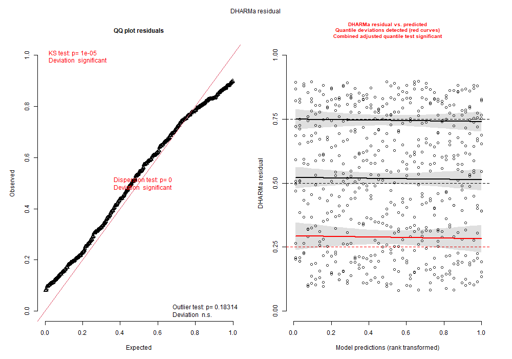
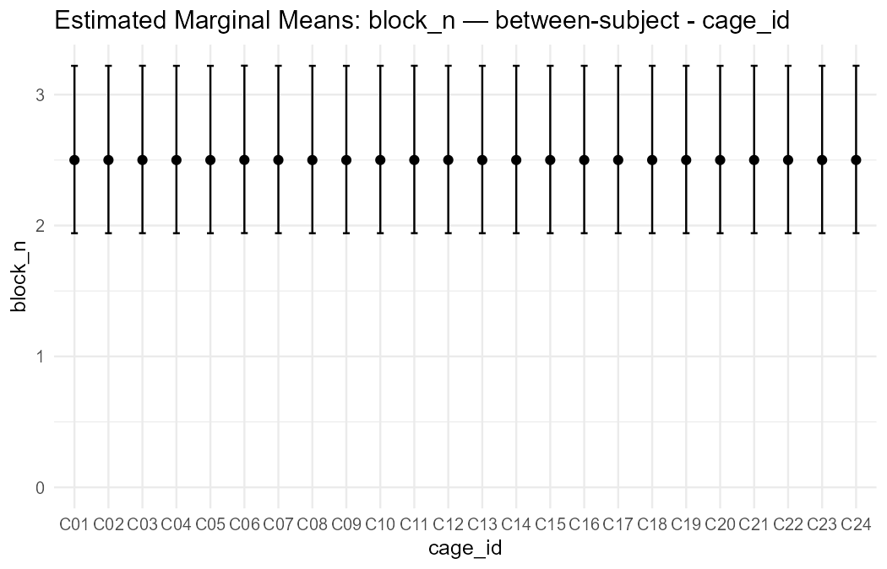

# LabStats GLMM Report

## Section 0 - Analysis Parameters

- Input file: C:\Users\pfh3221\OneDrive - Université de Moncton\Documents\GitHub2\gLMM_GUI_R\5CSRTT_synthetique.xlsx
- Sheet: sessions
- Animal ID: animal_id
- Run timestamp: 2026-10-30 13:36:16
- Program used: glmm_analyzer_r_301026.py
- Computer ID: LT27971
- R version: R version 4.5.3 (2026-03-11 ucrt)

### Independent Variables
- cage_id (scope: between_subject; role: fixed_effect)
- cohort_id (scope: between_subject; role: fixed_effect)
- sex (scope: between_subject; role: fixed_effect)
- treatment (scope: between_subject; role: fixed_effect)

### Dependent Variables
- block_n (counts)

### Model formulas
- General formula (DV = dependent variable): DV ~ `cage_id` + `cohort_id` + `sex` + `treatment` + (1 | `animal_id`)
- block_n: `block_n` ~ `cage_id` + `cohort_id` + `sex` + `treatment` + (1 | `animal_id`)

## Section 1 - Methods

### block_n

Data for block_n were analyzed with a generalized linear mixed model using a Negative Binomial distribution and a log link. Random-effects strategy followed a funnel approach from maximal to random intercept-only when needed. DHARMa diagnostics were used for model validation (uniformity, outliers, residual structure), not as the primary model-selection engine, except when an explicit refit rule is stated. Post-hoc contrasts are FDR-corrected across all DVs (cross-DV Benjamini-Hochberg).

## Section 2 - Results by DV

### block_n (counts)
- Status: ok
- Used rows: 576 / 576 (NA dropped: 0)
- Random structure/model: (1|`animal_id`) + ziformula(~1)
- Model formula: `block_n` ~ `cage_id` + `cohort_id` + `sex` + `treatment` + (1 | `animal_id`)
- Family used: negative-binomial
- Nakagawa R2 marginal: NA
- Nakagawa R2 conditional: NA

Fixed effects:

- (Intercept): estimate=0.9163, p=<0.001 ***
- cage_idC02: estimate=3.918e-05, p=0.9998 
- cage_idC03: estimate=0.0001311, p=0.9994 
- cage_idC04: estimate=-2.056e-05, p=0.9999 
- cage_idC05: estimate=-2.22e-05, p=0.9999 
- cage_idC06: estimate=0.0003733, p=0.9984 
- cage_idC07: estimate=0.0001227, p=0.9995 
- cage_idC08: estimate=-6.404e-05, p=0.9997 
- cage_idC09: estimate=-4.791e-05, p=0.9998 
- cage_idC10: estimate=8.361e-05, p=0.9996 
- cage_idC11: estimate=0.0001598, p=0.9993 
- cage_idC12: estimate=0.0001586, p=0.9993 
- cage_idC13: estimate=1.834e-05, p=0.9999 
- cage_idC14: estimate=6.172e-05, p=0.9997 
- cage_idC15: estimate=6.188e-05, p=0.9997 
- cage_idC16: estimate=6.242e-05, p=0.9997 
- cage_idC17: estimate=5.48e-05, p=0.9998 
- cage_idC18: estimate=5.496e-05, p=0.9998 
- cage_idC19: estimate=8.525e-05, p=0.9996 
- cage_idC20: estimate=-1.208e-05, p=0.9999 
- cage_idC21: estimate=0.000115, p=0.9995 
- cage_idC22: estimate=7.14e-05, p=0.9997 
- cage_idC23: estimate=8.803e-05, p=0.9996 
- cage_idC24: estimate=0.0001867, p=0.9992 
- cohort_idH02: estimate=NA, p=NA 
- cohort_idH03: estimate=NA, p=NA 
- cohort_idH04: estimate=NA, p=NA 
- sexM: estimate=NA, p=NA 
- treatmentvehicle: estimate=8.503e-05, p=0.9987 
- (Intercept): estimate=-16.56, p=0.9198 

Type III Wald tests:

- 1: statistic=6.954, p=<0.001 ***
- 2: statistic=0.0002146, p=0.9998 
- 3: statistic=0.0007183, p=0.9994 
- 4: statistic=-0.0001126, p=0.9999 
- 5: statistic=-0.0001216, p=0.9999 
- 6: statistic=0.002045, p=0.9984 
- 7: statistic=0.0006723, p=0.9995 
- 8: statistic=-0.0003508, p=0.9997 
- 9: statistic=-0.0002624, p=0.9998 
- 10: statistic=0.000458, p=0.9996 
- 11: statistic=0.0008752, p=0.9993 
- 12: statistic=0.0008688, p=0.9993 
- 13: statistic=0.0001004, p=0.9999 
- 14: statistic=0.0003381, p=0.9997 
- 15: statistic=0.0003389, p=0.9997 
- 16: statistic=0.0003419, p=0.9997 
- 17: statistic=0.0003002, p=0.9998 
- 18: statistic=0.000301, p=0.9998 
- 19: statistic=0.0004669, p=0.9996 
- 20: statistic=-6.616e-05, p=0.9999 
- 21: statistic=0.0006298, p=0.9995 
- 22: statistic=0.0003911, p=0.9997 
- 23: statistic=0.0004822, p=0.9996 
- 24: statistic=0.001023, p=0.9992 
- 25: statistic=NA, p=NA 
- 26: statistic=NA, p=NA 
- 27: statistic=NA, p=NA 
- 28: statistic=NA, p=NA 
- 29: statistic=0.001613, p=0.9987 
- 30: statistic=-0.1007, p=0.9198 

Post-hoc contrasts (IRR) -- raw p / cross-DV FDR p:

- C01 H01 F / C02 H01 F: effect=NA, p_raw=0.9998, p_fdr=1.0000 
- C01 H01 F / C03 H01 F: effect=NA, p_raw=0.9994, p_fdr=1.0000 
- C01 H01 F / C07 H02 F: effect=NA, p_raw=0.9995, p_fdr=1.0000 
- C01 H01 F / C08 H02 F: effect=NA, p_raw=0.9997, p_fdr=1.0000 
- C01 H01 F / C09 H02 F: effect=NA, p_raw=0.9998, p_fdr=1.0000 
- C01 H01 F / C13 H03 F: effect=NA, p_raw=0.9999, p_fdr=1.0000 
- C01 H01 F / C14 H03 F: effect=NA, p_raw=0.9997, p_fdr=1.0000 
- C01 H01 F / C15 H03 F: effect=NA, p_raw=0.9997, p_fdr=1.0000 
- C01 H01 F / C19 H04 F: effect=NA, p_raw=0.9996, p_fdr=1.0000 
- C01 H01 F / C20 H04 F: effect=NA, p_raw=0.9999, p_fdr=1.0000 
- C01 H01 F / C21 H04 F: effect=NA, p_raw=0.9995, p_fdr=1.0000 
- C01 H01 F / C04 H01 M: effect=NA, p_raw=0.9999, p_fdr=1.0000 
- C01 H01 F / C05 H01 M: effect=NA, p_raw=0.9999, p_fdr=1.0000 
- C01 H01 F / C06 H01 M: effect=NA, p_raw=0.9984, p_fdr=1.0000 
- C01 H01 F / C10 H02 M: effect=NA, p_raw=0.9996, p_fdr=1.0000 
- C01 H01 F / C11 H02 M: effect=NA, p_raw=0.9993, p_fdr=1.0000 
- C01 H01 F / C12 H02 M: effect=NA, p_raw=0.9993, p_fdr=1.0000 
- C01 H01 F / C16 H03 M: effect=NA, p_raw=0.9997, p_fdr=1.0000 
- C01 H01 F / C17 H03 M: effect=NA, p_raw=0.9998, p_fdr=1.0000 
- C01 H01 F / C18 H03 M: effect=NA, p_raw=0.9998, p_fdr=1.0000 
- C01 H01 F / C22 H04 M: effect=NA, p_raw=0.9997, p_fdr=1.0000 
- C01 H01 F / C23 H04 M: effect=NA, p_raw=0.9996, p_fdr=1.0000 
- C01 H01 F / C24 H04 M: effect=NA, p_raw=0.9992, p_fdr=1.0000 
- C02 H01 F / C03 H01 F: effect=NA, p_raw=0.9996, p_fdr=1.0000 
- C02 H01 F / C07 H02 F: effect=NA, p_raw=0.9996, p_fdr=1.0000 
- C02 H01 F / C08 H02 F: effect=NA, p_raw=0.9995, p_fdr=1.0000 
- C02 H01 F / C09 H02 F: effect=NA, p_raw=0.9996, p_fdr=1.0000 
- C02 H01 F / C13 H03 F: effect=NA, p_raw=0.9999, p_fdr=1.0000 
- C02 H01 F / C14 H03 F: effect=NA, p_raw=0.9999, p_fdr=1.0000 
- C02 H01 F / C15 H03 F: effect=NA, p_raw=0.9999, p_fdr=1.0000 
- C02 H01 F / C19 H04 F: effect=NA, p_raw=0.9998, p_fdr=1.0000 
- C02 H01 F / C20 H04 F: effect=NA, p_raw=0.9998, p_fdr=1.0000 
- C02 H01 F / C21 H04 F: effect=NA, p_raw=0.9997, p_fdr=1.0000 
- C02 H01 F / C04 H01 M: effect=NA, p_raw=0.9997, p_fdr=1.0000 
- C02 H01 F / C05 H01 M: effect=NA, p_raw=0.9997, p_fdr=1.0000 
- C02 H01 F / C06 H01 M: effect=NA, p_raw=0.9985, p_fdr=1.0000 
- C02 H01 F / C10 H02 M: effect=NA, p_raw=0.9998, p_fdr=1.0000 
- C02 H01 F / C11 H02 M: effect=NA, p_raw=0.9995, p_fdr=1.0000 
- C02 H01 F / C12 H02 M: effect=NA, p_raw=0.9995, p_fdr=1.0000 
- C02 H01 F / C16 H03 M: effect=NA, p_raw=0.9999, p_fdr=1.0000 
- C02 H01 F / C17 H03 M: effect=NA, p_raw=0.9999, p_fdr=1.0000 
- C02 H01 F / C18 H03 M: effect=NA, p_raw=0.9999, p_fdr=1.0000 
- C02 H01 F / C22 H04 M: effect=NA, p_raw=0.9999, p_fdr=1.0000 
- C02 H01 F / C23 H04 M: effect=NA, p_raw=0.9998, p_fdr=1.0000 
- C02 H01 F / C24 H04 M: effect=NA, p_raw=0.9994, p_fdr=1.0000 
- C03 H01 F / C07 H02 F: effect=NA, p_raw=1.0000, p_fdr=1.0000 
- C03 H01 F / C08 H02 F: effect=NA, p_raw=0.9991, p_fdr=1.0000 
- C03 H01 F / C09 H02 F: effect=NA, p_raw=0.9992, p_fdr=1.0000 
- C03 H01 F / C13 H03 F: effect=NA, p_raw=0.9995, p_fdr=1.0000 
- C03 H01 F / C14 H03 F: effect=NA, p_raw=0.9997, p_fdr=1.0000 
- C03 H01 F / C15 H03 F: effect=NA, p_raw=0.9997, p_fdr=1.0000 
- C03 H01 F / C19 H04 F: effect=NA, p_raw=0.9998, p_fdr=1.0000 
- C03 H01 F / C20 H04 F: effect=NA, p_raw=0.9994, p_fdr=1.0000 
- C03 H01 F / C21 H04 F: effect=NA, p_raw=0.9999, p_fdr=1.0000 
- C03 H01 F / C04 H01 M: effect=NA, p_raw=0.9993, p_fdr=1.0000 
- C03 H01 F / C05 H01 M: effect=NA, p_raw=0.9993, p_fdr=1.0000 
- C03 H01 F / C06 H01 M: effect=NA, p_raw=0.9989, p_fdr=1.0000 
- C03 H01 F / C10 H02 M: effect=NA, p_raw=0.9998, p_fdr=1.0000 
- C03 H01 F / C11 H02 M: effect=NA, p_raw=0.9999, p_fdr=1.0000 
- C03 H01 F / C12 H02 M: effect=NA, p_raw=0.9999, p_fdr=1.0000 
- C03 H01 F / C16 H03 M: effect=NA, p_raw=0.9997, p_fdr=1.0000 
- C03 H01 F / C17 H03 M: effect=NA, p_raw=0.9997, p_fdr=1.0000 
- C03 H01 F / C18 H03 M: effect=NA, p_raw=0.9997, p_fdr=1.0000 
- C03 H01 F / C22 H04 M: effect=NA, p_raw=0.9997, p_fdr=1.0000 
- C03 H01 F / C23 H04 M: effect=NA, p_raw=0.9998, p_fdr=1.0000 
- C03 H01 F / C24 H04 M: effect=NA, p_raw=0.9998, p_fdr=1.0000 
- C07 H02 F / C08 H02 F: effect=NA, p_raw=0.9992, p_fdr=1.0000 
- C07 H02 F / C09 H02 F: effect=NA, p_raw=0.9993, p_fdr=1.0000 
- C07 H02 F / C13 H03 F: effect=NA, p_raw=0.9995, p_fdr=1.0000 
- C07 H02 F / C14 H03 F: effect=NA, p_raw=0.9997, p_fdr=1.0000 
- C07 H02 F / C15 H03 F: effect=NA, p_raw=0.9997, p_fdr=1.0000 
- C07 H02 F / C19 H04 F: effect=NA, p_raw=0.9998, p_fdr=1.0000 
- C07 H02 F / C20 H04 F: effect=NA, p_raw=0.9994, p_fdr=1.0000 
- C07 H02 F / C21 H04 F: effect=NA, p_raw=1.0000, p_fdr=1.0000 
- C07 H02 F / C04 H01 M: effect=NA, p_raw=0.9994, p_fdr=1.0000 
- C07 H02 F / C05 H01 M: effect=NA, p_raw=0.9994, p_fdr=1.0000 
- C07 H02 F / C06 H01 M: effect=NA, p_raw=0.9989, p_fdr=1.0000 
- C07 H02 F / C10 H02 M: effect=NA, p_raw=0.9998, p_fdr=1.0000 
- C07 H02 F / C11 H02 M: effect=NA, p_raw=0.9998, p_fdr=1.0000 
- C07 H02 F / C12 H02 M: effect=NA, p_raw=0.9998, p_fdr=1.0000 
- C07 H02 F / C16 H03 M: effect=NA, p_raw=0.9997, p_fdr=1.0000 
- C07 H02 F / C17 H03 M: effect=NA, p_raw=0.9997, p_fdr=1.0000 
- C07 H02 F / C18 H03 M: effect=NA, p_raw=0.9997, p_fdr=1.0000 
- C07 H02 F / C22 H04 M: effect=NA, p_raw=0.9998, p_fdr=1.0000 
- C07 H02 F / C23 H04 M: effect=NA, p_raw=0.9998, p_fdr=1.0000 
- C07 H02 F / C24 H04 M: effect=NA, p_raw=0.9997, p_fdr=1.0000 
- C08 H02 F / C09 H02 F: effect=NA, p_raw=0.9999, p_fdr=1.0000 
- C08 H02 F / C13 H03 F: effect=NA, p_raw=0.9996, p_fdr=1.0000 
- C08 H02 F / C14 H03 F: effect=NA, p_raw=0.9995, p_fdr=1.0000 
- C08 H02 F / C15 H03 F: effect=NA, p_raw=0.9994, p_fdr=1.0000 
- C08 H02 F / C19 H04 F: effect=NA, p_raw=0.9993, p_fdr=1.0000 
- C08 H02 F / C20 H04 F: effect=NA, p_raw=0.9998, p_fdr=1.0000 
- C08 H02 F / C21 H04 F: effect=NA, p_raw=0.9992, p_fdr=1.0000 
- C08 H02 F / C04 H01 M: effect=NA, p_raw=0.9998, p_fdr=1.0000 
- C08 H02 F / C05 H01 M: effect=NA, p_raw=0.9998, p_fdr=1.0000 
- C08 H02 F / C06 H01 M: effect=NA, p_raw=0.9981, p_fdr=1.0000 
- C08 H02 F / C10 H02 M: effect=NA, p_raw=0.9994, p_fdr=1.0000 
- C08 H02 F / C11 H02 M: effect=NA, p_raw=0.9990, p_fdr=1.0000 
- C08 H02 F / C12 H02 M: effect=NA, p_raw=0.9990, p_fdr=1.0000 
- C08 H02 F / C16 H03 M: effect=NA, p_raw=0.9994, p_fdr=1.0000 
- C08 H02 F / C17 H03 M: effect=NA, p_raw=0.9995, p_fdr=1.0000 
- C08 H02 F / C18 H03 M: effect=NA, p_raw=0.9995, p_fdr=1.0000 
- C08 H02 F / C22 H04 M: effect=NA, p_raw=0.9994, p_fdr=1.0000 
- C08 H02 F / C23 H04 M: effect=NA, p_raw=0.9993, p_fdr=1.0000 
- C08 H02 F / C24 H04 M: effect=NA, p_raw=0.9989, p_fdr=1.0000 
- C09 H02 F / C13 H03 F: effect=NA, p_raw=0.9997, p_fdr=1.0000 
- C09 H02 F / C14 H03 F: effect=NA, p_raw=0.9995, p_fdr=1.0000 
- C09 H02 F / C15 H03 F: effect=NA, p_raw=0.9995, p_fdr=1.0000 
- C09 H02 F / C19 H04 F: effect=NA, p_raw=0.9994, p_fdr=1.0000 
- C09 H02 F / C20 H04 F: effect=NA, p_raw=0.9998, p_fdr=1.0000 
- C09 H02 F / C21 H04 F: effect=NA, p_raw=0.9993, p_fdr=1.0000 
- C09 H02 F / C04 H01 M: effect=NA, p_raw=0.9999, p_fdr=1.0000 
- C09 H02 F / C05 H01 M: effect=NA, p_raw=0.9999, p_fdr=1.0000 
- C09 H02 F / C06 H01 M: effect=NA, p_raw=0.9982, p_fdr=1.0000 
- C09 H02 F / C10 H02 M: effect=NA, p_raw=0.9994, p_fdr=1.0000 
- C09 H02 F / C11 H02 M: effect=NA, p_raw=0.9991, p_fdr=1.0000 
- C09 H02 F / C12 H02 M: effect=NA, p_raw=0.9991, p_fdr=1.0000 
- C09 H02 F / C16 H03 M: effect=NA, p_raw=0.9995, p_fdr=1.0000 
- C09 H02 F / C17 H03 M: effect=NA, p_raw=0.9996, p_fdr=1.0000 
- C09 H02 F / C18 H03 M: effect=NA, p_raw=0.9996, p_fdr=1.0000 
- C09 H02 F / C22 H04 M: effect=NA, p_raw=0.9995, p_fdr=1.0000 
- C09 H02 F / C23 H04 M: effect=NA, p_raw=0.9994, p_fdr=1.0000 
- C09 H02 F / C24 H04 M: effect=NA, p_raw=0.9990, p_fdr=1.0000 
- C13 H03 F / C14 H03 F: effect=NA, p_raw=0.9998, p_fdr=1.0000 
- C13 H03 F / C15 H03 F: effect=NA, p_raw=0.9998, p_fdr=1.0000 
- C13 H03 F / C19 H04 F: effect=NA, p_raw=0.9997, p_fdr=1.0000 
- C13 H03 F / C20 H04 F: effect=NA, p_raw=0.9999, p_fdr=1.0000 
- C13 H03 F / C21 H04 F: effect=NA, p_raw=0.9996, p_fdr=1.0000 
- C13 H03 F / C04 H01 M: effect=NA, p_raw=0.9998, p_fdr=1.0000 
- C13 H03 F / C05 H01 M: effect=NA, p_raw=0.9998, p_fdr=1.0000 
- C13 H03 F / C06 H01 M: effect=NA, p_raw=0.9984, p_fdr=1.0000 
- C13 H03 F / C10 H02 M: effect=NA, p_raw=0.9997, p_fdr=1.0000 
- C13 H03 F / C11 H02 M: effect=NA, p_raw=0.9994, p_fdr=1.0000 
- C13 H03 F / C12 H02 M: effect=NA, p_raw=0.9994, p_fdr=1.0000 
- C13 H03 F / C16 H03 M: effect=NA, p_raw=0.9998, p_fdr=1.0000 
- C13 H03 F / C17 H03 M: effect=NA, p_raw=0.9998, p_fdr=1.0000 
- C13 H03 F / C18 H03 M: effect=NA, p_raw=0.9998, p_fdr=1.0000 
- C13 H03 F / C22 H04 M: effect=NA, p_raw=0.9998, p_fdr=1.0000 
- C13 H03 F / C23 H04 M: effect=NA, p_raw=0.9997, p_fdr=1.0000 
- C13 H03 F / C24 H04 M: effect=NA, p_raw=0.9993, p_fdr=1.0000 
- C14 H03 F / C15 H03 F: effect=NA, p_raw=1.0000, p_fdr=1.0000 
- C14 H03 F / C19 H04 F: effect=NA, p_raw=0.9999, p_fdr=1.0000 
- C14 H03 F / C20 H04 F: effect=NA, p_raw=0.9997, p_fdr=1.0000 
- C14 H03 F / C21 H04 F: effect=NA, p_raw=0.9998, p_fdr=1.0000 
- C14 H03 F / C04 H01 M: effect=NA, p_raw=0.9996, p_fdr=1.0000 
- C14 H03 F / C05 H01 M: effect=NA, p_raw=0.9996, p_fdr=1.0000 
- C14 H03 F / C06 H01 M: effect=NA, p_raw=0.9986, p_fdr=1.0000 
- C14 H03 F / C10 H02 M: effect=NA, p_raw=0.9999, p_fdr=1.0000 
- C14 H03 F / C11 H02 M: effect=NA, p_raw=0.9996, p_fdr=1.0000 
- C14 H03 F / C12 H02 M: effect=NA, p_raw=0.9996, p_fdr=1.0000 
- C14 H03 F / C16 H03 M: effect=NA, p_raw=1.0000, p_fdr=1.0000 
- C14 H03 F / C17 H03 M: effect=NA, p_raw=1.0000, p_fdr=1.0000 
- C14 H03 F / C18 H03 M: effect=NA, p_raw=1.0000, p_fdr=1.0000 
- C14 H03 F / C22 H04 M: effect=NA, p_raw=1.0000, p_fdr=1.0000 
- C14 H03 F / C23 H04 M: effect=NA, p_raw=0.9999, p_fdr=1.0000 
- C14 H03 F / C24 H04 M: effect=NA, p_raw=0.9995, p_fdr=1.0000 
- C15 H03 F / C19 H04 F: effect=NA, p_raw=0.9999, p_fdr=1.0000 
- C15 H03 F / C20 H04 F: effect=NA, p_raw=0.9997, p_fdr=1.0000 
- C15 H03 F / C21 H04 F: effect=NA, p_raw=0.9998, p_fdr=1.0000 
- C15 H03 F / C04 H01 M: effect=NA, p_raw=0.9996, p_fdr=1.0000 
- C15 H03 F / C05 H01 M: effect=NA, p_raw=0.9996, p_fdr=1.0000 
- C15 H03 F / C06 H01 M: effect=NA, p_raw=0.9986, p_fdr=1.0000 
- C15 H03 F / C10 H02 M: effect=NA, p_raw=0.9999, p_fdr=1.0000 
- C15 H03 F / C11 H02 M: effect=NA, p_raw=0.9996, p_fdr=1.0000 
- C15 H03 F / C12 H02 M: effect=NA, p_raw=0.9996, p_fdr=1.0000 
- C15 H03 F / C16 H03 M: effect=NA, p_raw=1.0000, p_fdr=1.0000 
- C15 H03 F / C17 H03 M: effect=NA, p_raw=1.0000, p_fdr=1.0000 
- C15 H03 F / C18 H03 M: effect=NA, p_raw=1.0000, p_fdr=1.0000 
- C15 H03 F / C22 H04 M: effect=NA, p_raw=1.0000, p_fdr=1.0000 
- C15 H03 F / C23 H04 M: effect=NA, p_raw=0.9999, p_fdr=1.0000 
- C15 H03 F / C24 H04 M: effect=NA, p_raw=0.9995, p_fdr=1.0000 
- C19 H04 F / C20 H04 F: effect=NA, p_raw=0.9996, p_fdr=1.0000 
- C19 H04 F / C21 H04 F: effect=NA, p_raw=0.9999, p_fdr=1.0000 
- C19 H04 F / C04 H01 M: effect=NA, p_raw=0.9995, p_fdr=1.0000 
- C19 H04 F / C05 H01 M: effect=NA, p_raw=0.9995, p_fdr=1.0000 
- C19 H04 F / C06 H01 M: effect=NA, p_raw=0.9987, p_fdr=1.0000 
- C19 H04 F / C10 H02 M: effect=NA, p_raw=1.0000, p_fdr=1.0000 
- C19 H04 F / C11 H02 M: effect=NA, p_raw=0.9997, p_fdr=1.0000 
- C19 H04 F / C12 H02 M: effect=NA, p_raw=0.9997, p_fdr=1.0000 
- C19 H04 F / C16 H03 M: effect=NA, p_raw=0.9999, p_fdr=1.0000 
- C19 H04 F / C17 H03 M: effect=NA, p_raw=0.9999, p_fdr=1.0000 
- C19 H04 F / C18 H03 M: effect=NA, p_raw=0.9999, p_fdr=1.0000 
- C19 H04 F / C22 H04 M: effect=NA, p_raw=0.9999, p_fdr=1.0000 
- C19 H04 F / C23 H04 M: effect=NA, p_raw=1.0000, p_fdr=1.0000 
- C19 H04 F / C24 H04 M: effect=NA, p_raw=0.9996, p_fdr=1.0000 
- C20 H04 F / C21 H04 F: effect=NA, p_raw=0.9994, p_fdr=1.0000 
- C20 H04 F / C04 H01 M: effect=NA, p_raw=1.0000, p_fdr=1.0000 
- C20 H04 F / C05 H01 M: effect=NA, p_raw=1.0000, p_fdr=1.0000 
- C20 H04 F / C06 H01 M: effect=NA, p_raw=0.9983, p_fdr=1.0000 
- C20 H04 F / C10 H02 M: effect=NA, p_raw=0.9996, p_fdr=1.0000 
- C20 H04 F / C11 H02 M: effect=NA, p_raw=0.9992, p_fdr=1.0000 
- C20 H04 F / C12 H02 M: effect=NA, p_raw=0.9993, p_fdr=1.0000 
- C20 H04 F / C16 H03 M: effect=NA, p_raw=0.9997, p_fdr=1.0000 
- C20 H04 F / C17 H03 M: effect=NA, p_raw=0.9997, p_fdr=1.0000 
- C20 H04 F / C18 H03 M: effect=NA, p_raw=0.9997, p_fdr=1.0000 
- C20 H04 F / C22 H04 M: effect=NA, p_raw=0.9996, p_fdr=1.0000 
- C20 H04 F / C23 H04 M: effect=NA, p_raw=0.9996, p_fdr=1.0000 
- C20 H04 F / C24 H04 M: effect=NA, p_raw=0.9991, p_fdr=1.0000 
- C21 H04 F / C04 H01 M: effect=NA, p_raw=0.9994, p_fdr=1.0000 
- C21 H04 F / C05 H01 M: effect=NA, p_raw=0.9994, p_fdr=1.0000 
- C21 H04 F / C06 H01 M: effect=NA, p_raw=0.9989, p_fdr=1.0000 
- C21 H04 F / C10 H02 M: effect=NA, p_raw=0.9999, p_fdr=1.0000 
- C21 H04 F / C11 H02 M: effect=NA, p_raw=0.9998, p_fdr=1.0000 
- C21 H04 F / C12 H02 M: effect=NA, p_raw=0.9998, p_fdr=1.0000 
- C21 H04 F / C16 H03 M: effect=NA, p_raw=0.9998, p_fdr=1.0000 
- C21 H04 F / C17 H03 M: effect=NA, p_raw=0.9997, p_fdr=1.0000 
- C21 H04 F / C18 H03 M: effect=NA, p_raw=0.9997, p_fdr=1.0000 
- C21 H04 F / C22 H04 M: effect=NA, p_raw=0.9998, p_fdr=1.0000 
- C21 H04 F / C23 H04 M: effect=NA, p_raw=0.9999, p_fdr=1.0000 
- C21 H04 F / C24 H04 M: effect=NA, p_raw=0.9997, p_fdr=1.0000 
- C04 H01 M / C05 H01 M: effect=NA, p_raw=1.0000, p_fdr=1.0000 
- C04 H01 M / C06 H01 M: effect=NA, p_raw=0.9983, p_fdr=1.0000 
- C04 H01 M / C10 H02 M: effect=NA, p_raw=0.9995, p_fdr=1.0000 
- C04 H01 M / C11 H02 M: effect=NA, p_raw=0.9992, p_fdr=1.0000 
- C04 H01 M / C12 H02 M: effect=NA, p_raw=0.9992, p_fdr=1.0000 
- C04 H01 M / C16 H03 M: effect=NA, p_raw=0.9996, p_fdr=1.0000 
- C04 H01 M / C17 H03 M: effect=NA, p_raw=0.9997, p_fdr=1.0000 
- C04 H01 M / C18 H03 M: effect=NA, p_raw=0.9997, p_fdr=1.0000 
- C04 H01 M / C22 H04 M: effect=NA, p_raw=0.9996, p_fdr=1.0000 
- C04 H01 M / C23 H04 M: effect=NA, p_raw=0.9995, p_fdr=1.0000 
- C04 H01 M / C24 H04 M: effect=NA, p_raw=0.9991, p_fdr=1.0000 
- C05 H01 M / C06 H01 M: effect=NA, p_raw=0.9983, p_fdr=1.0000 
- C05 H01 M / C10 H02 M: effect=NA, p_raw=0.9995, p_fdr=1.0000 
- C05 H01 M / C11 H02 M: effect=NA, p_raw=0.9992, p_fdr=1.0000 
- C05 H01 M / C12 H02 M: effect=NA, p_raw=0.9992, p_fdr=1.0000 
- C05 H01 M / C16 H03 M: effect=NA, p_raw=0.9996, p_fdr=1.0000 
- C05 H01 M / C17 H03 M: effect=NA, p_raw=0.9997, p_fdr=1.0000 
- C05 H01 M / C18 H03 M: effect=NA, p_raw=0.9997, p_fdr=1.0000 
- C05 H01 M / C22 H04 M: effect=NA, p_raw=0.9996, p_fdr=1.0000 
- C05 H01 M / C23 H04 M: effect=NA, p_raw=0.9995, p_fdr=1.0000 
- C05 H01 M / C24 H04 M: effect=NA, p_raw=0.9991, p_fdr=1.0000 
- C06 H01 M / C10 H02 M: effect=NA, p_raw=0.9987, p_fdr=1.0000 
- C06 H01 M / C11 H02 M: effect=NA, p_raw=0.9991, p_fdr=1.0000 
- C06 H01 M / C12 H02 M: effect=NA, p_raw=0.9991, p_fdr=1.0000 
- C06 H01 M / C16 H03 M: effect=NA, p_raw=0.9986, p_fdr=1.0000 
- C06 H01 M / C17 H03 M: effect=NA, p_raw=0.9986, p_fdr=1.0000 
- C06 H01 M / C18 H03 M: effect=NA, p_raw=0.9986, p_fdr=1.0000 
- C06 H01 M / C22 H04 M: effect=NA, p_raw=0.9987, p_fdr=1.0000 
- C06 H01 M / C23 H04 M: effect=NA, p_raw=0.9988, p_fdr=1.0000 
- C06 H01 M / C24 H04 M: effect=NA, p_raw=0.9992, p_fdr=1.0000 
- C10 H02 M / C11 H02 M: effect=NA, p_raw=0.9997, p_fdr=1.0000 
- C10 H02 M / C12 H02 M: effect=NA, p_raw=0.9997, p_fdr=1.0000 
- C10 H02 M / C16 H03 M: effect=NA, p_raw=0.9999, p_fdr=1.0000 
- C10 H02 M / C17 H03 M: effect=NA, p_raw=0.9999, p_fdr=1.0000 
- C10 H02 M / C18 H03 M: effect=NA, p_raw=0.9999, p_fdr=1.0000 
- C10 H02 M / C22 H04 M: effect=NA, p_raw=0.9999, p_fdr=1.0000 
- C10 H02 M / C23 H04 M: effect=NA, p_raw=1.0000, p_fdr=1.0000 
- C10 H02 M / C24 H04 M: effect=NA, p_raw=0.9995, p_fdr=1.0000 
- C11 H02 M / C12 H02 M: effect=NA, p_raw=1.0000, p_fdr=1.0000 
- C11 H02 M / C16 H03 M: effect=NA, p_raw=0.9996, p_fdr=1.0000 
- C11 H02 M / C17 H03 M: effect=NA, p_raw=0.9995, p_fdr=1.0000 
- C11 H02 M / C18 H03 M: effect=NA, p_raw=0.9995, p_fdr=1.0000 
- C11 H02 M / C22 H04 M: effect=NA, p_raw=0.9996, p_fdr=1.0000 
- C11 H02 M / C23 H04 M: effect=NA, p_raw=0.9997, p_fdr=1.0000 
- C11 H02 M / C24 H04 M: effect=NA, p_raw=0.9999, p_fdr=1.0000 
- C12 H02 M / C16 H03 M: effect=NA, p_raw=0.9996, p_fdr=1.0000 
- C12 H02 M / C17 H03 M: effect=NA, p_raw=0.9995, p_fdr=1.0000 
- C12 H02 M / C18 H03 M: effect=NA, p_raw=0.9995, p_fdr=1.0000 
- C12 H02 M / C22 H04 M: effect=NA, p_raw=0.9996, p_fdr=1.0000 
- C12 H02 M / C23 H04 M: effect=NA, p_raw=0.9997, p_fdr=1.0000 
- C12 H02 M / C24 H04 M: effect=NA, p_raw=0.9999, p_fdr=1.0000 
- C16 H03 M / C17 H03 M: effect=NA, p_raw=1.0000, p_fdr=1.0000 
- C16 H03 M / C18 H03 M: effect=NA, p_raw=1.0000, p_fdr=1.0000 
- C16 H03 M / C22 H04 M: effect=NA, p_raw=1.0000, p_fdr=1.0000 
- C16 H03 M / C23 H04 M: effect=NA, p_raw=0.9999, p_fdr=1.0000 
- C16 H03 M / C24 H04 M: effect=NA, p_raw=0.9995, p_fdr=1.0000 
- C17 H03 M / C18 H03 M: effect=NA, p_raw=1.0000, p_fdr=1.0000 
- C17 H03 M / C22 H04 M: effect=NA, p_raw=0.9999, p_fdr=1.0000 
- C17 H03 M / C23 H04 M: effect=NA, p_raw=0.9999, p_fdr=1.0000 
- C17 H03 M / C24 H04 M: effect=NA, p_raw=0.9994, p_fdr=1.0000 
- C18 H03 M / C22 H04 M: effect=NA, p_raw=0.9999, p_fdr=1.0000 
- C18 H03 M / C23 H04 M: effect=NA, p_raw=0.9999, p_fdr=1.0000 
- C18 H03 M / C24 H04 M: effect=NA, p_raw=0.9994, p_fdr=1.0000 
- C22 H04 M / C23 H04 M: effect=NA, p_raw=0.9999, p_fdr=1.0000 
- C22 H04 M / C24 H04 M: effect=NA, p_raw=0.9995, p_fdr=1.0000 
- C23 H04 M / C24 H04 M: effect=NA, p_raw=0.9996, p_fdr=1.0000 
- H01 / H02: effect=NA, p_raw=0.9998, p_fdr=1.0000 
- H01 / H03: effect=NA, p_raw=0.9997, p_fdr=1.0000 
- H01 / H04: effect=NA, p_raw=0.9999, p_fdr=1.0000 
- H02 / H03: effect=NA, p_raw=0.9998, p_fdr=1.0000 
- H02 / H04: effect=NA, p_raw=0.9998, p_fdr=1.0000 
- H03 / H04: effect=NA, p_raw=0.9996, p_fdr=1.0000 
- F / M: effect=NA, p_raw=0.9991, p_fdr=1.0000 
- compound_A / vehicle: effect=NA, p_raw=0.9987, p_fdr=1.0000 
- DHARMa plot: C:\Users\pfh3221\OneDrive - Université de Moncton\Documents\GitHub2\gLMM_GUI_R\outputs\5CSRTT_synthetique/figures/dharma_qq_block_n.png

- EMMeans plot (between-subject): C:\Users\pfh3221\OneDrive - Université de Moncton\Documents\GitHub2\gLMM_GUI_R\outputs\5CSRTT_synthetique/figures/emmeans_block_n_cage_id.png

## Section 3 - Warnings and Diagnostics

### block_n
- WARNING: DHARMa KS/uniformity test significant (p=<0.001).
- WARNING: Zero-inflation detected by DHARMa; refitting as ZINB.

## Section 4 - Reporting Example

- For block_n: The treatment effect was evaluated with a GLMM (COUNTS) and reported as IRR with 95% confidence intervals and cross-DV FDR-corrected p-values (Benjamini-Hochberg across all DVs).
